# CleanShotZ

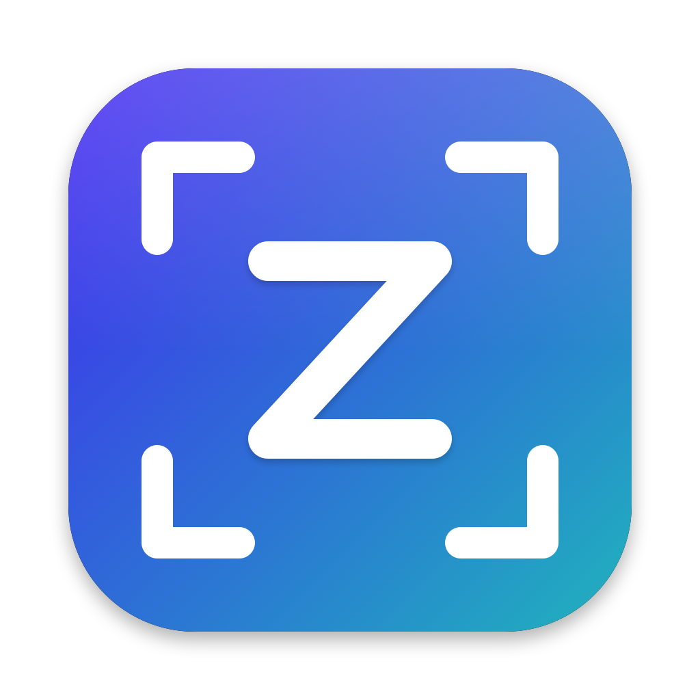

A free and open source macOS menu bar app for screenshots, screen recordings
and annotations, written in Rust. See [PLAN.md](PLAN.md) for the feature plan
and milestones.

> CleanShotZ is an independent project. It is not affiliated with, endorsed
> by or connected to CleanShot X or MakeTheWeb. "CleanShot" is a trademark of
> its respective owner.

CleanShotZ is in early development; see [CHANGELOG.md](CHANGELOG.md).

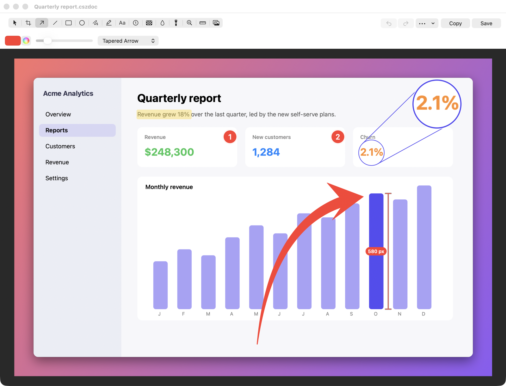

| Studio editor | Step capture guide |
| --- | --- |
| 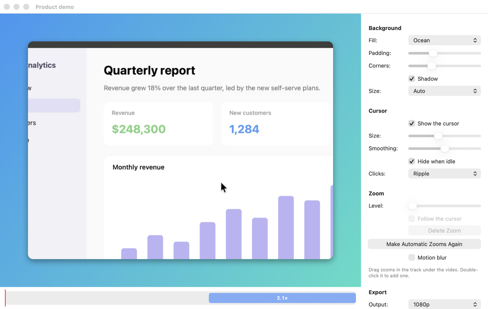 | 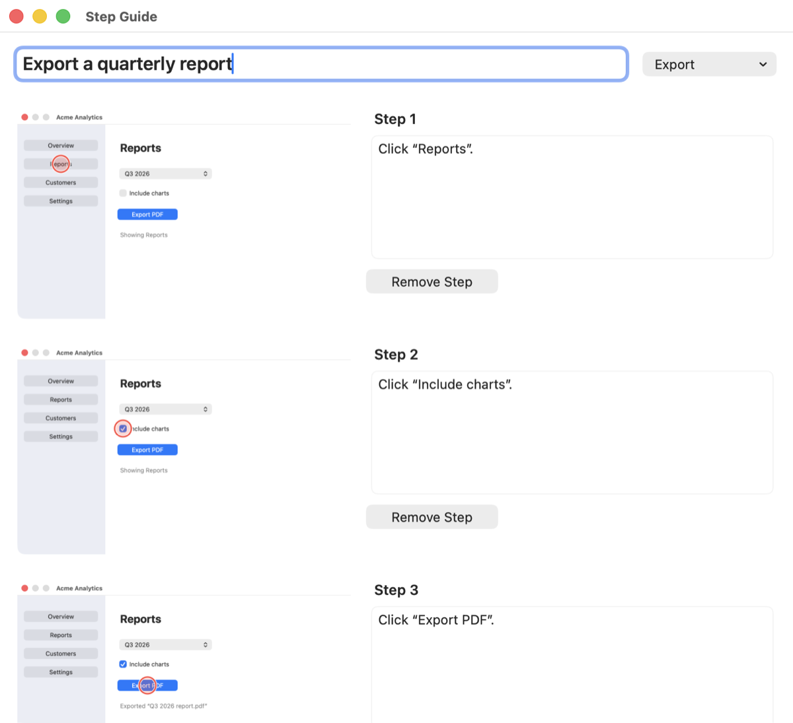 |

| Capture history | Quick Access Overlay |
| --- | --- |
| 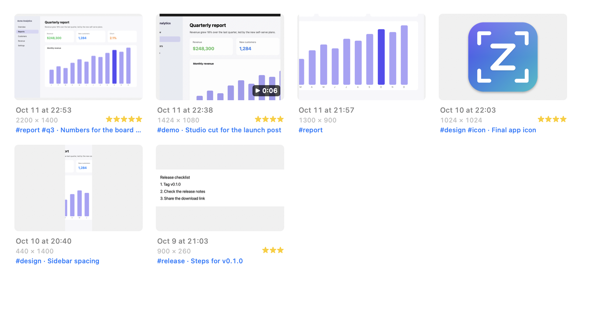 | 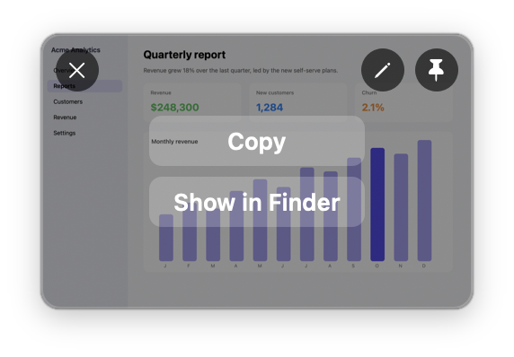 |

| Video editor | Recording controls |
| --- | --- |
| 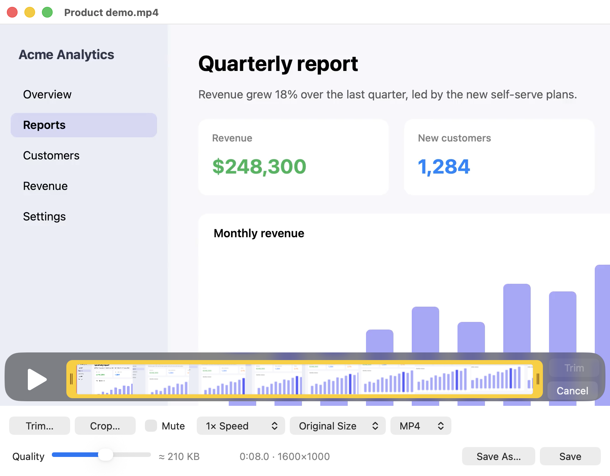 |  |

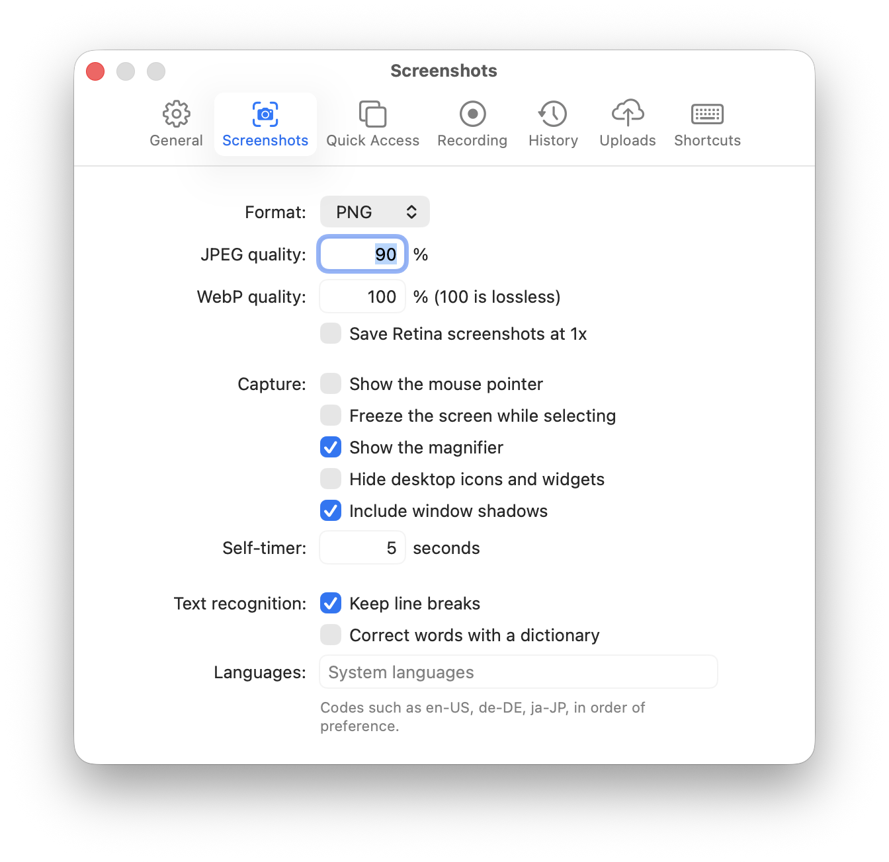

## Install

Requires macOS 14 or later on an Apple Silicon Mac. With
[Homebrew](https://brew.sh):

```sh
brew install --cask houseofmackee/tap/cleanshotz
```

This also puts the `cleanshotz` command line tool on your `PATH`. The app
updates itself (see [Updates](#updates)), so `brew upgrade` leaves it alone
unless you add `--greedy`. Or download `CleanShotZ-<version>.dmg` (or
the zip) from
[GitHub Releases](https://github.com/houseofmackee/cleanshotz/releases), open
it and drag CleanShotZ into Applications. `SHA256SUMS.txt` has the checksums.

CleanShotZ is signed with a Developer ID and notarized by Apple (since
0.6.0), so it opens like any other downloaded app.

### Updates

From 0.7.0 on, CleanShotZ updates itself with
[Sparkle](https://sparkle-project.org). On the second launch it asks whether
to check for updates automatically (once a day); change that later in
Settings > General, or choose Check for Updates… in the menu at any time.
When a scheduled check finds an update, the menu shows Update to CleanShotZ
<version>…, and the update window waits in the background instead of
interrupting. Updates are only installed after their EdDSA signature and
Apple's notarization check out. Pre-releases are not offered.

Updating from 0.6.0 or earlier is manual once: download the new release and
replace the app (quit it first), or `brew upgrade --cask cleanshotz`.
Every release is signed by the same developer, so macOS keeps the Screen
Recording and other permissions you gave it.

Coming from 0.5.0 or earlier: those releases were signed with a
self-signed certificate, so macOS treats 0.6.0 as a new app and asks for
Screen Recording, Accessibility and the other permissions again, once.
The old entries in System Settings > Privacy & Security can be removed.

## Privacy

No account, no telemetry, no crash reporting. CleanShotZ only uses the
network for uploads you configure and, if you allow it, update checks: they
fetch `appcast.xml` from GitHub Releases and send nothing about your Mac
(Sparkle's system profiling is off).

## Development

Requires a Rust toolchain (stable).

```sh
cargo xtask run          # build, bundle into target/debug/CleanShotZ.app, launch
cargo xtask bundle       # bundle only
cargo xtask bundle --release
cargo test --workspace
cargo clippy --workspace --all-targets -- -D warnings
```

`cargo xtask bundle --test` builds a separate "CleanShotZ Test" app with
its own bundle id and `cleanshotz-test://` URL scheme, for automated
testing next to a running CleanShotZ. Debug builds started with
`CLEANSHOTZ_NO_CONFIRM=1` discard unsaved annotations without asking, so
test runs never leave a dialog behind. `CLEANSHOTZ_FAKE_CAMERA=1` shows a
placeholder camera bubble and `CLEANSHOTZ_FAKE_KEYS=1` a keystroke display
fed by `cleanshotz-test://dev-show-key?code=8&flags=1048576`, so both can
be tested without camera or Input Monitoring access.

The app must run from its `.app` bundle (not the bare binary) for macOS to
attribute privacy permissions and the login item to it.

### Code signing and the Screen Recording permission

macOS ties the Screen Recording permission to the app's code signature. An
ad-hoc signature changes on every build, so macOS would forget the permission
after each rebuild. Builds are therefore signed with a self-signed
certificate, which keeps the signature's designated requirement stable.

Once per machine, create it in your login keychain:

```sh
cargo xtask create-dev-cert
```

`cargo xtask bundle` and `run` then sign with "CleanShotZ Dev" automatically.
To use a different identity, set `CLEANSHOTZ_SIGN_IDENTITY` to its name or
SHA-1. Without any identity, builds fall back to ad-hoc signing. The
certificate is not marked as trusted and does not need to be.

### Releases

Releases are signed with a Developer ID Application certificate and
notarized with an App Store Connect API key (Developer role). The release
workflow reads the certificate from the `DEVELOPER_ID_P12_BASE64` and
`DEVELOPER_ID_P12_PASSWORD` secrets, the key from `NOTARY_API_KEY_BASE64`,
and the `APPLE_TEAM_ID`, `NOTARY_KEY_ID` and `NOTARY_ISSUER_ID` variables.
Keep backups of the `.p12` and `.p8` outside GitHub. Releases up to 0.5.0
used a self-signed "CleanShotZ Release" certificate
(`cargo xtask create-release-cert`), which still works for builds without
an Apple developer account.

`cargo xtask dist` builds the signed release bundle, with Sparkle
(downloaded at a pinned version and checksum) inside, and packages it in
`target/dist` (zip, DMG, `SHA256SUMS.txt`). With `CLEANSHOTZ_SPARKLE_KEY`
(the path to the EdDSA private key; the workflow uses the
`SPARKLE_PRIVATE_KEY` secret) it also writes a signed `appcast.xml`, with
the release notes from this version's CHANGELOG section; the release
workflow attaches it to the release, and the app reads it from
`releases/latest/download/appcast.xml`. Back the key up outside GitHub:
without it, installed copies can't verify new updates. With a Developer ID in the
keychain it signs with it (set `CLEANSHOTZ_TEAM_ID` to pick a team), and
with `CLEANSHOTZ_NOTARY_KEY` (the `.p8` path), `CLEANSHOTZ_NOTARY_KEY_ID`
and `CLEANSHOTZ_NOTARY_ISSUER` it also notarizes and staples the app and
the DMG. Pushing a version tag runs the
same in the [release workflow](.github/workflows/release.yml) and publishes
a GitHub release; the tag must match the version in `Cargo.toml`:

```sh
git tag v0.1.0 && git push origin v0.1.0
```

A hyphenated tag (`v0.2.0-beta.1`) makes a pre-release. The workflow then
updates the cask in
[houseofmackee/homebrew-tap](https://github.com/houseofmackee/homebrew-tap)
to the new version, with the `TAP_DEPLOY_KEY` secret (a deploy key with
write access to that repository).

### Files

| What | Where |
| --- | --- |
| Settings | `~/Library/Application Support/CleanShotZ/config.toml` |
| Logs | `~/Library/Logs/CleanShotZ/cleanshotz.log` (level via `RUST_LOG`) |

Set `CLEANSHOTZ_SKIP_ONBOARDING=1` to skip the first-launch permission dialog.

## Settings

Choose Settings… from the menu (Cmd+,) to change options in tabs: General,
Screenshots, Quick Access, Recording, History, Uploads and Shortcuts.
Changes apply at once. Everything is stored in the settings file (see
[Files](#files)), which can also be edited by hand; choose Reload Settings
afterwards. The tables below list each option's name in the file. Upload
secrets typed into Settings are stored in the Keychain, not the file.

## Shortcuts

Defaults avoid the system screenshot shortcuts (Cmd+Shift+3/4/5). To change
one, open Settings > Shortcuts, click it and press the new keys (Escape
cancels, Delete removes it). A shortcut used by another action moves to the
new one. In the `[hotkeys]` section of the settings file the format is
modifiers (`cmd`, `shift`, `alt`/`opt`, `ctrl`) and one key, joined with
`+`, for example `cmd+shift+4` or `f5`. An empty string disables a shortcut.

| Action | Default |
| --- | --- |
| Capture Area | `alt+shift+4` |
| Capture Previous Area | `alt+shift+2` |
| Capture Fullscreen | `alt+shift+3` |
| Capture Window | `alt+shift+w` |
| Self-Timer | none |
| Scrolling Capture | `alt+shift+s` |
| Capture Text | `alt+shift+o` |
| Pick Color | none |
| Step Capture | none |
| Record Screen | `alt+shift+5` |
| Record Screen (Studio) | none |
| Capture History | none |

## Capturing

- **Capture Area:** drag to select, release to capture. Hold Shift for a
  square, Option to grow from the center, Space while dragging to move the
  selection. Arrow keys move the pointer by 1 point (10 with Shift). Press
  Space before dragging to switch to window mode. Escape or right click
  cancels. Hold Command to snap to the button, field or panel under the
  pointer (it is outlined with its size); a click then captures exactly
  that element. Elements in other apps are found through the
  accessibility API, so this needs Accessibility permission.
- **Capture Window:** hover a window and click. Saved on a transparent
  background, with the window shadow by default.
- **Capture Fullscreen:** the display under the pointer. On a display with
  a camera housing, the black band a full-screen app leaves beside it is
  cropped away (`crop_notch`).
- **Capture Previous Area:** the last selected area again, without the overlay.
- **Self-Timer:** select an area or window, then capture after a countdown.
- **Scrolling Capture** (`alt+shift+s`): select the part of a window that
  scrolls (stay inside the window), then scroll slowly, down or sideways:
  the direction is picked up from your first scroll. Or click Auto-scroll
  and it scrolls to the end by itself (needs Accessibility). A preview
  beside the area grows as you go. Click Done to stitch everything into
  one tall (or wide) image; sticky headers and sidebars appear once and
  scroll bars are removed.
- **Capture Text:** select an area (or press Space and pick a window); the
  text in it is recognized on your Mac and copied to the clipboard. If the
  area is mostly a QR code (or another barcode), or has no other text, the
  code's content is copied instead; for a link, click the confirmation to
  open it.
- **Pick Color:** the magnifier shows the pixel under the pointer and its
  hex value. Click (or press Return) to copy it as `#RRGGBB`, or drag to
  copy the average color of an area. Hold Shift to copy `rgb(r, g, b)`
  instead. Colors are converted to sRGB, so they match what browsers and
  design apps show. Escape cancels.
- **Step Capture:** for step-by-step guides. While it runs, every click
  in another app saves a screenshot of the window under the pointer with
  the click ringed. Click Done in the bar at the bottom of the screen (or
  run Step Capture again) to open the steps as a guide (see below).

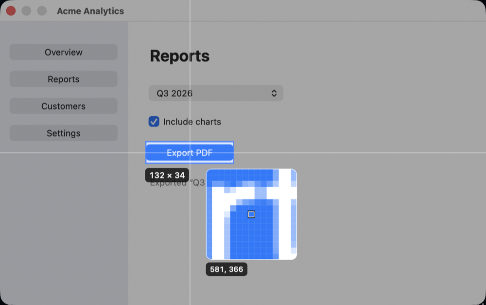
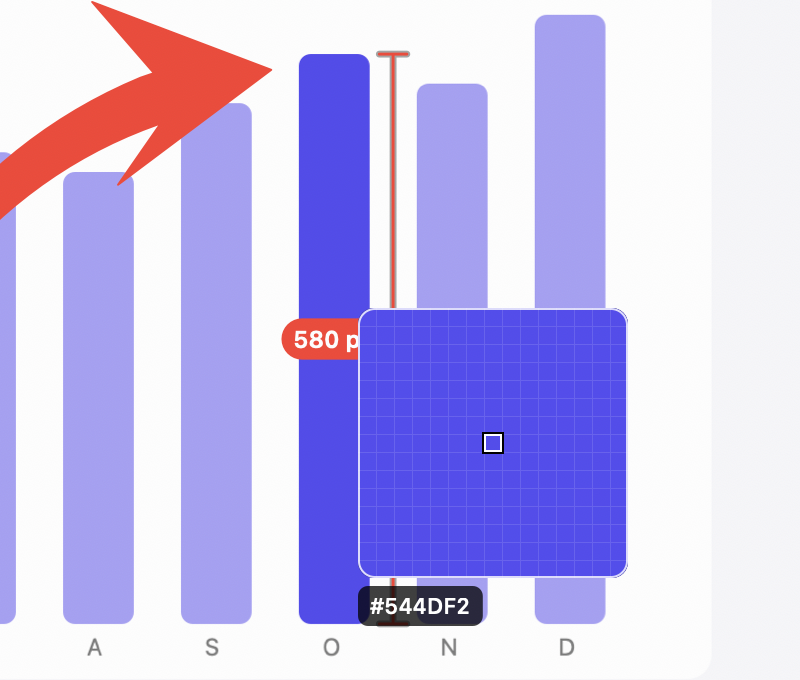

Captures are copied to the clipboard (as PNG) and saved to the Desktop by
default. Options live in the `[capture]` section of the settings file:

| Setting | Default | Meaning |
| --- | --- | --- |
| `copy_to_clipboard` | `true` | Copy each capture to the clipboard |
| `save_to_file` | `true` | Save each capture to `save_directory` |
| `save_directory` | `"~/Desktop"` | Where captures are saved |
| `file_name` | `"CleanShotZ {date} at {time}"` | File name; Retina captures get an `@2x` suffix |
| `format` | `"png"` | `"png"`, `"jpeg"` or `"webp"` |
| `jpeg_quality` | `0.9` | 0.0 to 1.0 |
| `webp_quality` | `1.0` | 0.0 to 1.0; 1.0 is lossless |
| `downscale_retina` | `false` | Save Retina captures at 1x |
| `convert_to_srgb` | `false` | Convert captures from the display's color space to sRGB, so colors look the same on other screens |
| `show_cursor` | `false` | Include the pointer in area and fullscreen captures |
| `freeze_screen` | `false` | Freeze the screen while selecting |
| `hide_desktop_icons` | `false` | Leave desktop icons and widgets out of captures |
| `window_shadow` | `true` | Keep the shadow in window captures |
| `crop_notch` | `true` | Crop the black band beside the camera housing from full-screen captures of full-screen apps |
| `show_magnifier` | `true` | Show the pixel magnifier while selecting |
| `self_timer_seconds` | `5` | Countdown length, 1 to 60 |
| `play_sound` | `true` | Play the macOS screenshot sound |
| `pipeline` | `""` | A pipeline to run after every screenshot instead (see below) |

The clipboard always gets PNG. WebP files are written in sRGB; lossless
WebP files are usually noticeably smaller than PNG for screenshots.

### Step capture


The guide window lists the steps in order, each with its screenshot and a
caption. Captions start out naming what was clicked ("Click “Export
PDF”.", "Choose “Save As…”.", "Click the “Email” field.") when the app
exposes it through the accessibility API (with Accessibility
permission), or the app otherwise; what is typed into fields is never
read. Edit the title and captions, remove steps you don't want, then
Export:

- **Markdown…** writes `Guide.md` and the images in a `Guide` folder next
  to it, linked relatively, ready for a repository or wiki.
- **HTML…** writes one page with the images inside it, to send or host as
  is.
- **PDF…** lays the guide out on pages of your default paper size, keeping
  each step on one page.

Window shadows are left out. Double-clicks count as one step, and a guide
holds up to 100 steps. Closing a guide that was not exported asks first.

### Pipelines

A pipeline is a list of steps run on a screenshot instead of the usual
copy, save and thumbnail handling. Define pipelines in the `[pipelines]`
section of the settings file, then pick one under Settings > General to run
after every screenshot, pass `pipeline=NAME` with a capture command (URL or
command line), or run one on an existing image with
`cleanshotz run-pipeline --name NAME --filepath FILE`.

```toml
[pipelines]
share = ["resize 50%", "background", "format webp 85%", "upload", "copy-link"]
safe = ["redact", "save", "copy"]
slack = ["save", "open Slack"]
```

| Step | Does |
| --- | --- |
| `resize 50%`, `resize 1280px`, `resize 1x` | Scale by a percentage, to at most a width, or to one pixel per point |
| `background [preset]` | Put the image on a saved background preset, or on the editor's default background |
| `redact` | Cover emails, API keys, tokens, card numbers and similar text |
| `srgb` | Convert to sRGB |
| `format png`, `format jpeg 80%`, `format webp [85%]` | The format of files written after this step (WebP without a quality is lossless) |
| `save [folder]` | Save to the save folder, or to `folder` |
| `copy` | Copy the image to the clipboard |
| `upload` | Upload with the configured destination |
| `copy-link` | Copy the upload link |
| `open [app]` | Open the file in its default app, or in `app` |
| `run <command>` | Run a shell command with the file as `$1`; `CLEANSHOTZ_FILE` and `CLEANSHOTZ_LINK` are set |
| `annotate`, `pin`, `quick-access` | Open in the editor, pin, or show the thumbnail |

Steps that need a file use the last one saved, or write the current image to
the history folder. If a step fails, the pipeline stops and says why; the
capture is still recorded in history.

### Text recognition

Options live in the `[text]` section of the settings file:

| Setting | Default | Meaning |
| --- | --- | --- |
| `keep_line_breaks` | `true` | Keep line breaks; `false` joins lines with spaces |
| `languages` | `[]` | Languages to recognize, for example `["en-US", "de-DE"]`; empty uses your system's preferred languages |
| `language_correction` | `false` | Dictionary-based correction; helps with photos of text, hurts code and identifiers |

### Screen recording

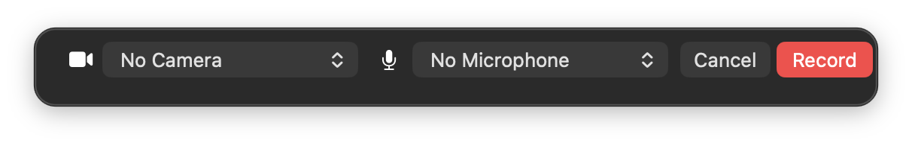


Record Screen (`alt+shift+5`) shows the selection overlay: drag to record an
area, click to record the whole screen, or press Space and click a window.
Then, as in QuickTime Player, a panel below it lets you choose the camera
(or none) and the microphone (or none); choosing a camera shows its bubble
right away. Record (Return, or Record Screen again) starts recording and
Cancel (Escape) stops there. The choice is remembered for next time. Turn
the panel off in Settings > Recording to record with the last choice right
away; recordings started with an area from a script or the command line
skip it.
After a short countdown a control bar appears below the area with the
elapsed time and Pause, Stop and Discard; a red border marks the recorded
area. Neither shows up in the recording. Press the shortcut again (or
choose Stop Recording in the menu) to stop. The recording appears in Quick
Access: drag it out, Copy (puts the file on the clipboard), Save, or
double-click to open it in the video editor.

Options live in the `[recording]` section of the settings file:

| Setting | Default | Meaning |
| --- | --- | --- |
| `format` | `"mp4"` | `"mp4"` or `"gif"` |
| `codec` | `"auto"` | `"auto"` (H.264, or HEVC when larger than 4096 x 2304), `"h264"` or `"hevc"` |
| `fps` | `30` | Frames per second |
| `quality` | `"high"` | `"low"`, `"medium"` or `"high"` |
| `downscale_retina` | `false` | Record at 1x instead of Retina resolution |
| `show_cursor` | `true` | Include the pointer |
| `show_clicks` | `true` | Highlight clicks |
| `highlight_cursor` | `false` | Keep a soft yellow circle around the pointer, stronger while a button is held |
| `hide_notifications` | `true` | Leave notification banners out of recordings |
| `system_audio` | `false` | Record sound from apps |
| `microphone` | `false` | Record the microphone |
| `separate_audio_tracks` | `false` | Keep system audio and the microphone on two tracks instead of mixing them into one |
| `countdown_seconds` | `3` | Countdown before recording; `0` starts at once |
| `gif_fps` | `15` | GIF frame rate |
| `gif_max_width` | `1280` | Larger GIFs are scaled down to this width in pixels |
| `camera` | `false` | Show your camera in a bubble that is part of the recording; drag it anywhere |
| `camera_size` | `180` | Bubble size in points |
| `camera_shape` | `"circle"` | `"circle"` or `"rounded"` |
| `keystrokes` | `"off"` | Show pressed keys: `"off"`, `"shortcuts"` or `"all"` |
| `studio` | `false` | Record in Studio mode (see below) |
| `choose_devices` | `true` | Choose the camera and microphone in a panel before recording |
| `camera_device`, `microphone_device` | `""` | The camera and microphone to use (set by the panel); empty for the system default |

The camera needs camera access and the keystroke display needs Input
Monitoring; macOS asks the first time. `"shortcuts"` only shows presses with
Command, Control or Option and keys that never type text (arrows, Return,
Escape, function keys), so typed text such as passwords never appears in a
recording. Both are shown in area and full-screen recordings, not in window
recordings, and so is the cursor highlight.

With both system audio and the microphone on, the two are mixed into one
track after recording (many players and websites only play the first
track); the video is copied, not re-encoded. Notification banners are left
out of recordings instead of switching on Do Not Disturb, so they still
reach you; desktop widgets stay in the recording. On macOS 14 the
microphone is recorded through AVFoundation and clicks are drawn by the
cursor overlay, since ScreenCaptureKit can do neither there.

While the microphone records, a level meter sits next to the timer in the
recording bar. If the microphone picks up nothing at all in the first few
seconds (muted, or the wrong input chosen), a message says so.

### Studio recordings


Record Screen (Studio), or Record Screen with Studio mode on in Settings >
Recording, records the screen without the pointer and keeps the pointer's
movements, clicks, pressed keys and the camera apart. The recording opens
in the Studio editor, where all of them can be changed afterwards:

- **Background:** the image editor's fills, saved presets and the desktop
  picture, with padding, rounded corners, a shadow and sizes for social
  media.
- **Cursor:** shown or hidden, 0.5 to 3 times its size, smoothed (it still
  lands exactly where you clicked), hidden when it rests, and a ripple or
  ring on clicks.
- **Zoom:** zooms are made automatically where you click and type, and
  follow the pointer (looking a little ahead, so they arrive in time).
  The track under the video shows them: drag one to move it or its edges
  to resize it, double-click to add one, Delete to remove it. Each has a
  level (1.25 to 4 times) and follows the pointer or stays put. Motion blur
  is optional.
- **Camera** (when it was on): its corner, size and shape, or hidden.
- **Keys** (when shown while recording): at the bottom or top, any size,
  or hidden.

Export MP4 renders the result at 1080p, 1440p, 4K or the original size,
at 60 frames per second and faster than real time, and shows it in Quick
Access. A Studio recording is a `.cszrec` file (a folder that macOS shows
as one file) holding the screen video, the camera, the events and your
edits; it is listed in Capture History and opens from there or from
Finder. AppleScript (`record screen with studio`), Shortcuts (Record
Screen's Studio option) and the URL scheme (`studio=true`) can start one.

### Video editor


Click the scissors on a recording's thumbnail, double-click it, or open a
video with Open in Editor…. Trim… shows QuickTime's trim bar: drag the
yellow handles and click Trim. Crop… lets you drag the area to keep over
the video (drag inside it to move it, drag a corner to resize; Return
finishes, Escape removes the crop). The speed menu plays the result from
0.5× to 4× (the sound keeps its pitch; the player previews the speed).
Mute removes the sound, the size menu scales down to 1080p, 720p or 540p
(never up), and MP4 or GIF picks the format. The Quality slider sets the
bitrate when the video is re-encoded; next to it are the expected file
size, the result's length and its size in pixels. Save replaces the
recording (a GIF is saved next to it); Save As… saves a copy anywhere.

When only trimming or muting, the video is copied without re-encoding, so
it keeps its quality and saves quickly. Cropping, a speed change, a
smaller size or moving the Quality slider re-encode it.

### Capture history


Capture History… in the menu shows every screenshot and recording, newest
first. Search finds captures by the text in them (recognized on your Mac in
the background), by file name, note or tag, and the filter switches between
all, screenshots, recordings and starred ones. Double-click to open;
right-click to Annotate or Edit, Copy, Show in Finder, Pin, Print, Upload or
Delete. Delete and Cmd+C work from the keyboard too.

To organize captures, press 1 to 5 to give the selected one stars (0
removes them; or use Rating in the context menu), and choose Tags and
Note… to tag it and add a note. Tags and the start of the note show under
the thumbnail. Search for `#bug` to see only captures tagged bug (`#bug
#ui` needs both), or pick a tag from the Tags menu. Starred captures are
kept however old they get.

Captures you don't save are kept in `~/Library/Application Support/CleanShotZ/History`
for as long as history keeps them. Deleting such an entry deletes its file;
deleting an entry for a saved file leaves the file alone. Options live in
the `[history]` section of the settings file:

| Setting | Default | Meaning |
| --- | --- | --- |
| `enabled` | `true` | Keep a history of captures |
| `retention_days` | `30` | Remove entries older than this (starred ones are kept); `0` keeps them |
| `recognize_text` | `true` | Recognize text in screenshots for search |

### Uploads

Upload a capture from the cloud button on its thumbnail, from the History
window's context menu, or from the command line with
`cleanshotz upload FILE`. The link is copied to the clipboard and saved with
the capture in history. Nothing is uploaded until you choose a destination in
the `[upload]` section of the settings file:

| Setting | Default | Meaning |
| --- | --- | --- |
| `destination` | `"none"` | `"http"`, `"s3"`, `"imgur"`, `"script"` or `"none"` |
| `auto_upload` | `false` | Upload every capture and recording right away |

Any value can say `"keychain:NAME"` to read a secret from the Keychain
instead of the settings file. Store one with
`cleanshotz secret set NAME` (it reads the secret from standard input) and
remove it with `cleanshotz secret delete NAME`.

**HTTP** (`[upload.http]`) sends a multipart form POST, or the raw file with
`method = "PUT"`:

```toml
[upload.http]
url = "https://example.com/upload"
method = "POST"           # or "PUT"
field = "file"            # form field for the file
link = "json:data.link"   # "text", "json:a.b" or "header:Location"
headers = { Authorization = "keychain:my-token" }
form = { expires = "7d" } # extra form fields
```

**S3** (`[upload.s3]`) works with AWS S3, Cloudflare R2, MinIO and other
S3-compatible storage. Requests are signed with Signature Version 4:

```toml
[upload.s3]
bucket = "screenshots"
region = "us-east-1"
endpoint = ""            # empty for AWS; otherwise e.g. "https://<account>.r2.cloudflarestorage.com"
access_key_id = "AKIA..."
secret_access_key = "keychain:s3-secret"
prefix = "shots/"
public_url = "https://cdn.example.com"  # base of the copied link; empty uses the bucket URL
acl = ""                 # e.g. "public-read"
```

**Script** (`[upload.script]`) runs `command` in a shell with the file path
as its argument; the first line it prints is the link.

**Imgur** (`[upload.imgur]`) uploads anonymously; anyone with the link can
see the image. Imgur asks every app for its own `client_id`: register one
at <https://api.imgur.com/oauth2/addclient> (anonymous usage, no callback
URL) and paste it into Settings > Uploads.

### Quick Access Overlay

Each capture appears as a thumbnail in the bottom-left corner. Hover it to
Copy, Save (or Show in Finder once saved), Annotate, Pin, Upload or Close it. Drag it
into any app to drop the image file there, or double-click it to annotate
it. Closed
thumbnails can be brought back with Restore Recently Closed in the menu.
Options live in the `[quick_access]` section of the settings file:

| Setting | Default | Meaning |
| --- | --- | --- |
| `enabled` | `true` | Show thumbnails after capturing |
| `position` | `"left"` | `"left"` or `"right"` corner |
| `auto_close_seconds` | `0` | Close thumbnails after this many seconds; 0 keeps them |
| `close_after_drag` | `true` | Close a thumbnail after dragging it into an app |

### Pinned screenshots

Pin a thumbnail to keep the capture floating above all windows, at the
place it was captured. Drag to move it, or drag a corner to resize it (it
keeps its shape). Pinch, Cmd+= and Cmd+- zoom; Cmd+0 returns to actual
size; Cmd+C copies; Escape or Cmd+W closes. Right click for opacity, Save
As, Lock (clicks pass through to the windows below) and Arrange All Pins,
which tiles every pin on the screen, scaling them down together if they do
not fit. Arrange and unlock pins from the menu bar too.

### Annotation editor

Open a capture from its thumbnail (Annotate, or double-click), any image or
project with Open in Editor…, or the clipboard image with Annotate Clipboard
Image.

| Tool | Key | |
| --- | --- | --- |
| Select | V | Click to select, drag to move, drag handles to resize, Delete to remove |
| Crop | C | Drag a region; Return applies, Escape resets |
| Arrow | A | Tapered (a solid shape that widens into a swept-back head; the default), filled, open or double-headed; drag the middle handle to curve it |
| Line | L | |
| Rectangle, Ellipse | R, O | Outline or filled |
| Pen, Highlighter | P, H | Freehand; the highlighter can snap to lines of text |
| Text | T | Click to type, Return to finish; plain or on a colored background |
| Counter | N | Numbered steps, counting up |
| Pixelate, Blur | X, B | Hide sensitive content |
| Spotlight | S | Dim everything else |
| Magnify | M | Drag out a spot to show it zoomed in a circle beside it |
| Measure | U | Drag to measure in pixels, or click to measure the run of one color |
| Background | G | Gradient, solid or image backdrop with padding, rounded corners, shadow, aspect ratio and Balance |

Hold Shift for squares, circles and 45-degree lines. Color, width and style
changes apply to the selected annotation too. Cmd+Z and Shift+Cmd+Z undo and
redo; Cmd+C copies the result; Cmd+S saves. Save writes over the capture (or,
for opened images, saves a new capture). The ••• menu has Save As…, Save
Project…, Pin to Screen, Copy Text, Redact Sensitive Info, Add Image to the
Right… / Below…, Rotate Right / Left, Flip Horizontally / Vertically,
Resize…, Export Before/After GIF… and Print… (Cmd+P). Printing scales the
image to the page width; a scrolling capture taller than a page continues
on the next pages instead of shrinking.

**Hand-drawn:** with arrows (other than tapered), lines and outlined
rectangles and ellipses, the Hand-drawn checkbox draws them as if sketched
by hand; they look the same every time they are drawn.

**Curved arrows:** a selected arrow has a handle in its middle; drag it to
bend the arrow. Drag it back to the middle to straighten it.

**Magnify** (M): drag from the middle of the detail outward. The zoomed
circle appears beside it (twice the size; resize it by its corners to zoom
more or less), joined by two lines. Drag the zoomed circle to move it; the
handle in the middle of the spot moves the spot, the one on its edge
resizes it. Only the capture itself is magnified, not annotations.

**Measure** (U): drag to measure; Shift keeps the line straight across or
up and down. The label shows the length in image pixels (width × height
for a slanted line). A click measures the run of one color through that
point across (Shift-click: up and down), which measures a button, a bar or
a gap in one click.

**Snap to Text:** choose it in the Highlighter's menu, and a stroke over
text becomes a marker over the words it crosses, at the height of the line.
The text is recognized on your Mac the first time.

**Overlay compare:** select a pasted or added image and set its opacity in
the menu next to the width slider to line two captures up. Export
Before/After GIF… saves a two-frame GIF: without and with the top image.

**Backgrounds:** the aspect menu has sizes for social media (1:1, 4:5,
9:16, 16:9, 4:3, 3:2, and 1.91:1 for link previews). Balance trims margins
of one plain color, so the content sits in the middle. Window captures
(with their transparent shadow) lose their own shadow on a background, and
the background's shadow takes its place; a window capture's Quick Access
thumbnail has an Add Background button that opens it in the editor with the
last background you chose.

**Rotate and flip** (Cmd+R and Shift+Cmd+R rotate) turn the image with
everything on it; text stays upright. **Resize…** sets the size of the
exported image in pixels or as a percentage, keeping proportions (1x gives
a Retina capture one pixel per point); annotations are drawn at the new size, so they
stay sharp. Both are undoable and saved in projects.

**Images and combining captures:** Cmd+V pastes an image (or a copied image
file) as a layer you can move and resize; corner handles keep its shape.
Drop images onto the canvas the same way, including Quick Access thumbnails
of other captures. Layers can sit beyond the original capture: the canvas
grows to include them, so placing captures side by side (or using Add Image
to the Right… / Below…) combines them into one image.

**Backgrounds:** besides the built-in gradients and colors, the Background
menu offers the Desktop Wallpaper and Choose Image…, and Save as Preset…
keeps the current background (fill, padding, corners, shadow and aspect
ratio) under a name. Presets are stored in `backgrounds.json` next to the
settings file; image presets keep their own copy of the image in
`Backgrounds/`. Pipelines can use them with the `background NAME` step.

**Redact Sensitive Info** finds emails, IP addresses, card numbers (checked
with the Luhn algorithm), US Social Security numbers, API keys and tokens
(AWS, GitHub, Slack, Stripe, Google, OpenAI, Anthropic, GitLab, npm), JWTs,
private keys and other random-looking secrets, and covers them with solid
boxes in one undo step. Solid boxes, not pixelation: pixelated text can
sometimes be reconstructed. Text recognition runs entirely on your Mac.

Projects (`.cszdoc`) keep the original image and every annotation (image
layers and image backgrounds included) editable.
They are plain JSON, documented in `src/editor/project.rs`.

### URL scheme and command line

Every command can be run as a URL, `open "cleanshotz://<command>?<parameters>"`,
or from the command line as `cleanshotz <command> --<parameter> <value>`.
Commands and parameters match
[CleanShot X's URL scheme](https://cleanshot.com/docs-api), so existing
scripts only need the scheme name changed. The command line reports errors
(and exits with status 1), starts the app if it is not running, and makes
relative file paths absolute. Link `CleanShotZ.app/Contents/MacOS/cleanshotz`
into your `PATH` to use it.

| Command | Parameters |
| --- | --- |
| `capture-area` | `x`, `y`, `width`, `height`, `display`, `action` or `pipeline` |
| `capture-previous-area` | `action` or `pipeline` |
| `capture-fullscreen` | `action` or `pipeline` |
| `capture-window` | `action` or `pipeline` |
| `self-timer` | `action` or `pipeline` |
| `scrolling-capture` | `x`, `y`, `width`, `height`, `display`, `autoscroll`, `start` |
| `all-in-one` | `x`, `y`, `width`, `height`, `display` (same as `capture-area`) |
| `capture-text` | `filepath`, `x`, `y`, `width`, `height`, `display`, `linebreaks` |
| `pick-color` | none |
| `step-capture` | none (starts a step capture, or finishes the running one) |
| `record-screen` | `x`, `y`, `width`, `height`, `display`, `studio` |
| `pin` | `filepath` (asks for a file without it) |
| `open-annotate` | `filepath` (asks for a file without it) |
| `open-from-clipboard` | none |
| `add-quick-access-overlay` | `filepath` (an image or video) |
| `hide-desktop-icons`, `show-desktop-icons`, `toggle-desktop-icons` | none |
| `open-history` | none |
| `restore-recently-closed` | none |
| `open-settings` | `tab`: CleanShot's names, plus `history` and `uploads` |
| `run-pipeline` | `name`, `filepath` |
| `quit` | none (command line only) |

- `x`, `y`, `width` and `height` are points from the bottom-left corner of
  the display. With them, the area is captured, recorded or scrolled at once
  instead of being selected. `display` is 1 for the main display, 2 for the
  next and so on; without it, the display under the pointer.
- `action` is `copy`, `save`, `annotate`, `upload` or `pin`: what to do with
  the screenshot instead of the usual copy and save settings. `pipeline`
  runs a [pipeline](#pipelines) instead. `run-pipeline` and `pipeline` are
  CleanShotZ additions.
- `linebreaks=false` joins recognized lines with spaces.
- `autoscroll=true` starts Auto-scroll. `start` is accepted for
  compatibility; scrolling capture always starts once the area is chosen.
- Hiding desktop icons covers them (and widgets) with the wallpaper. Finder
  is not restarted, and quitting CleanShotZ shows them again.

```sh
cleanshotz capture-area --x 0 --y 0 --width 800 --height 600 --action pin
cleanshotz capture-text --filepath ~/Desktop/receipt.png --linebreaks false
open "cleanshotz://record-screen?x=100&y=100&width=1280&height=720"
```

### AppleScript

Every command is also an AppleScript command, with the same parameters
(open CleanShotZ in Script Editor's Library to see the dictionary):

```applescript
tell application "CleanShotZ"
    capture area x 0 y 0 width 800 height 600 action "pin"
    capture fullscreen pipeline "share"
    capture text from file (POSIX file "/tmp/receipt.png") without line breaks
    run pipeline named "share" from file "/tmp/shot.png"
    open settings tab "shortcuts"
end tell
```

The first time a script controls CleanShotZ, macOS asks you to allow it.

### Shortcuts

CleanShotZ also offers actions to the Shortcuts app (and Spotlight): Capture
Area, Capture Fullscreen, Capture Window, Capture Previous Area (each with an
optional "Then" action), Capture Text, Pick Color, Step Capture, Scrolling
Capture, Record Screen, Open Capture History, Hide Desktop Icons and Run Pipeline. Search for
CleanShotZ in the Shortcuts app's action list. Every command is also available through
the Open URLs action (`cleanshotz://...`), Run AppleScript, or Run Shell
Script with the command line.

Building the actions needs Xcode (for `appintentsmetadataprocessor`); with
only the Command Line Tools the app builds without them.

### Raycast

The [`raycast`](raycast) folder holds a Raycast extension with commands for
every capture mode, recording, Pick Color, Step Capture, Capture History, and annotating,
pinning or running a pipeline on the image selected in Finder. It uses the
URL scheme, so it needs nothing beyond CleanShotZ. To try it: `cd raycast &&
npm install && npm run dev`.

## Translating

CleanShotZ looks up the text it shows by its English wording in
`resources/<language>.lproj/Localizable.strings`, falling back to English.
`cargo xtask strings` writes the current English text to
`resources/en.lproj/Localizable.strings`. To add a language, copy that file
to, for example, `resources/de.lproj/Localizable.strings` and translate the
right-hand side of each line. Keep placeholders such as `{n}` or `{file}`
as they are; a translation may move them within the sentence. Bundles
include every `.lproj` folder; macOS picks the language from System
Settings > General > Language & Region (or per app, under Applications).

Menus, alerts, notifications, the Settings window, tool names, status text
and VoiceOver descriptions are covered, and dates and file sizes follow the
system's format for the language. Error details from the command line, the
URL scheme, pipelines and uploads stay in English. Plurals have one form for
2 and more (`{n} captures`), which fits most but not all languages.

## License

Licensed under either of

- Apache License, Version 2.0 ([LICENSE-APACHE](LICENSE-APACHE))
- MIT license ([LICENSE-MIT](LICENSE-MIT))

at your option.

Distributed builds include [Sparkle](https://sparkle-project.org) for
updates, under its own MIT-style license; the notice ships in the app as
`Contents/Resources/Sparkle-LICENSE.txt`.

Unless you explicitly state otherwise, any contribution intentionally
submitted for inclusion in the work by you, as defined in the Apache-2.0
license, shall be dual licensed as above, without any additional terms or
conditions.
